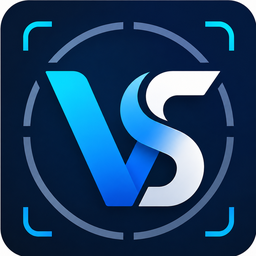
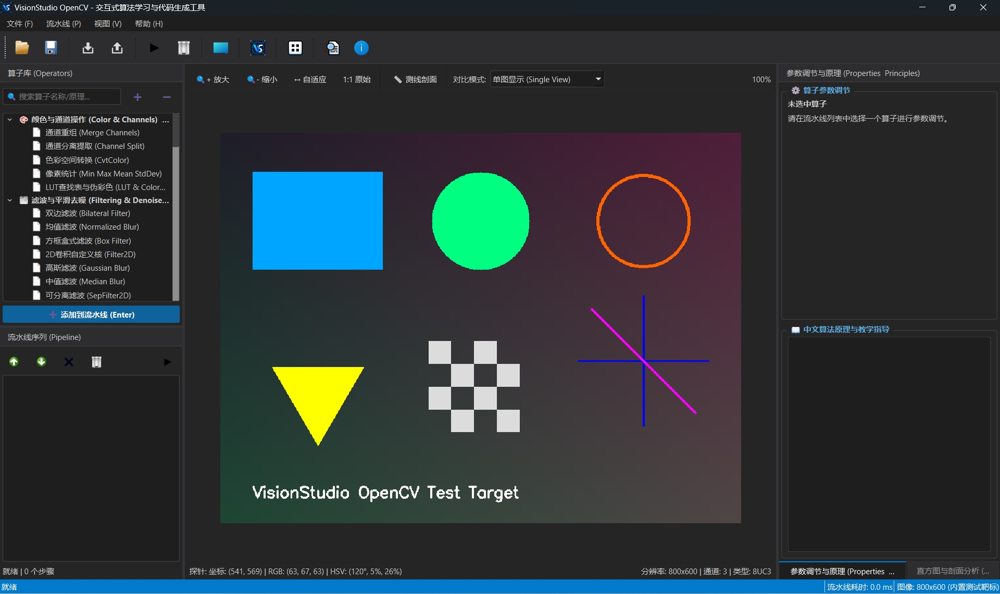

# VisionStudio OpenCV 🚀

<p align="center">
  
</p>

<p align="center">
  <strong>现代化工业级交互式机器视觉算法工作台与多语言代码生成引擎</strong>
</p>

<p align="center">
  <em>Interactive Computer Vision Simulation, Real-time Pipeline Debugging & Code Generation Workbench based on Qt & OpenCV</em>
</p>

<p align="center">
  
  
  
  
  
  
  
</p>

---

## 📖 目录

- [🌟 项目简介](#-项目简介)
- [🖥️ 软件界面效果图](#️-软件界面效果图)
- [✨ 核心功能亮点](#-核心功能亮点)
- [🚀 5 分钟快速入门](#-5-分钟快速入门)
- [🛠️ 编译构建与部署指南](#️-编译构建与部署指南)
  - [系统与环境要求](#系统与环境要求)
  - [方式一：CMake 命令行构建 (推荐)](#方式一cmake-命令行构建-推荐)
  - [方式二：Qt Creator IDE 一键构建](#方式二qt-creator-ide-一键构建)
  - [方式三：Visual Studio 2022 构建](#方式三visual-studio-2022-构建)
  - [自动化单元测试](#自动化单元测试)
  - [一键免安装绿色便携包打包](#一键免安装绿色便携包打包)
- [📖 软件功能与使用指南](#-软件功能与使用指南)
  - [交互式视口：缩放、平移与帘幕分屏对比](#1-交互式视口缩放平移与帘幕分屏对比)
  - [交互式掩码编辑器 (Alt+M)](#2-交互式掩码编辑器-altm)
  - [多通道直方图与剖面分析](#3-多通道直方图与剖面分析)
  - [双引擎多语言代码实时生成 (Alt+C)](#4-双引擎多语言代码实时生成-altc)
  - [工程持久化与序列化 (.json)](#5-工程持久化与序列化-json)
  - [常用快捷键一览表](#常用快捷键一览表)
- [🧩 算子库全景分类 (60+ 算子)](#-算子库全景分类-60-算子)
- [🏛️ 软件分层架构与扩展开发](#️-软件分层架构与扩展开发)
- [📚 文档导航](#-文档导航)
- [📄 开源协议](#-开源协议)

---

## 🌟 项目简介

在传统机器视觉与 OpenCV 开发流程中，工程师通常需要：
> **编写代码 ➔ 编译运行 ➔ 观察效果 ➔ 重新修改参数 ➔ 再次编译**

这一流程极其耗时繁琐。而 Halcon、VisionPro 等工业商业软件虽然具备可视化交互调试能力，但闭源且费用昂贵，难以灵活转换为可在嵌入式设备或生产线端直接运行的原生 OpenCV 代码。

**VisionStudio OpenCV** 正是为解决这一痛点而打造的开源利器！它基于 **Qt C++** 与 **OpenCV** 构建，完美融合了：
1. **类似 Halcon 的拖拽式可视化算子流水线交互**：实时调节参数、单步断点检查、前后效果分屏对比。
2. **毫秒级增量计算引擎**：脏标记驱动，修改参数仅重算受影响下游步骤，保持 60 FPS 流畅反馈。
3. **原生 OpenCV 工业级源码即时生成**：调试完成即可一键导出干净、标准、可直接嵌入项目的 **C++ (OpenCV)** 与 **Python (cv2)** 代码！

---

## 🖥️ 软件界面效果图



### 核心功能分区速览：
* **左侧上方**：**算子库分类树 (Operators)** —— 包含 11 大类别 60+ 算子，支持关键字中英文快速模糊过滤。
* **左侧下方**：**流水线序列 (Pipeline)** —— 拖拽式组装视觉流程，支持节点启禁用、拖拽重排、单步耗时精确统计与断点状态查看。
* **中央视口**：**高性能图像视口 (ImageViewer)** —— 支持鼠标平滑缩放、自由平移、1:1/适应窗口、**左右分屏帘幕对比 (Split View)** 与 **实时 RGB/HSV 像素探针**。
* **右侧上方**：**动态参数面板与算法原理教学 (Properties & Principles)** —— 根据算子自动呈现滑块与控件，内嵌详尽中文数学原理与工业现场调参提示。
* **右侧下方**：**直方图与剖面分析 (Histogram Analysis)** —— 实时统计 R/G/B 及灰度分布直方图，输出均值、方差、极值等统计特征。
* **底部折叠**：**双引擎多语言代码生成 (Code Preview, `Alt+C`)** 与 **运行日志控制台 (`Alt+L`)** —— 实时语法高亮生成标准 C++ 与 Python 源码，支持一键复制代码与导出脚本。

---

## ✨ 核心功能亮点

- 🧰 **全景算子库 (60+ 工业级算子)**：覆盖色彩通道、滤波降噪、自适应阈值、形态学运算、几何变换、边缘梯度、轮廓特征、霍夫检测、模板匹配、图像增强与 Hu 矩统计等 11 大类。
- ⚡ **毫秒级增量执行引擎**：采用有向流水线设计与脏标记缓存机制，单步参数调节只重算受影响的下游算子，亚毫秒级实时响应。
- 🔍 **交互式高精度视口系统**：支持滚轮无级平滑缩放、鼠标右键平移、1:1 像素对齐、分屏帘幕前后对比与悬浮实时像素探针（(X, Y) 坐标、RGB/HSV 像素值）。
- 🎭 **交互式掩码编辑器 (Mask Editor, `Alt+M`)**：提供画笔、橡皮擦、矩形/椭圆选区、自动阈值提取、选区反相与原图混合（`BlendWithSource`），轻松实现复杂工件的局部 ROI 处理与缺陷修补。
- 📊 **多通道直方图与图像统计**：实时展示 RGB 分离及灰度直方图，毫秒级计算像素总数、均值、标准差、最大/最小值，辅助精准定阈。
- 💻 **双引擎实时工业级代码生成 (`Alt+C`)**：实时生成具备完整包含头文件、标准命名空间与异常处理的 **C++ (OpenCV)** 及 **Python (cv2)** 代码，支持一键复制与文件导出。
- 📁 **工程状态持久化与事务保护 (`.json`)**：完整保存/加载流水线参数配置，采用事务级回滚与跨平台 UTF-8 中文路径编解码，保障工程安全。
- 🎨 **Visual Studio 级深色工业主题**：全自由停靠、嵌套、多 Tab 组合 Dock 系统，完美支持 Windows 10/11 原生沉浸式暗色标题栏。

---

## 🚀 5 分钟快速入门

```
【打开图像】(Ctrl+O) ➔ 【搜索/添加算子】 ➔ 【调节参数】(实时预览) ➔ 【帘幕对比】 ➔ 【导出代码】(Alt+C)
```

1. **打开图像**：点击工具栏 **「打开图像」**（`Ctrl+O`）载入本地图片，或直接使用软件自带的标准测试图。
2. **构建流水线**：在左侧算子库中搜索 `高斯滤波`、`Canny`、`轮廓分析`，**双击** 或 **拖拽** 加入流水线。
3. **交互调参**：点击选中某一算子，在右侧属性面板拖动滑块，中央视口 **实时更新处理效果**。
4. **分屏对比**：点击视口工具栏 **「帘幕对比」** 按钮，左右滑动分割线对比原图与滤波/增强细节差异。
5. **获取代码**：按快捷键 `Alt+C` 唤出底部代码面板，点击 **「一键复制代码」**，即可将标准 C++ / Python 代码粘贴进您的项目中直接运行！

---

## 🛠️ 编译构建与部署指南

### 系统与环境要求

| 依赖组件 | 最低要求 | 推荐配置 |
| :--- | :--- | :--- |
| **操作系统** | Windows 10 (64-bit) | Windows 10 / 11 (64-bit) |
| **编译器** | C++17 兼容编译器 | MinGW-w64 GCC 11+ / MSVC 2019 / 2022 |
| **构建工具** | CMake >= 3.16 | CMake >= 3.20 + Ninja |
| **Qt 框架** | Qt 5.15+ | Qt 6.8.x / Qt 6.5.x (Widgets, Core, Gui) |
| **OpenCV** | OpenCV 3.4.x / 4.x | OpenCV 4.9.0 / 4.8.0 (含 `objdetect` 模块) |

---

### 方式一：CMake 命令行构建 (推荐)

在 Windows PowerShell 或 Terminal 中执行：

```powershell
# 1. 克隆本仓库并进入目录
git clone https://github.com/YourUsername/VisionStudio-OpenCV.git
cd "VisionStudio-OpenCV"

# 2. 创建并进入构建目录
mkdir build -ErrorAction SilentlyContinue
cd build

# 3. 运行 CMake 配置 (根据实际情况指定 Qt 与 OpenCV 路径)
cmake .. -G "Ninja" `
  -DCMAKE_BUILD_TYPE=Release `
  -DCMAKE_PREFIX_PATH="D:/Qt/6.8.2/mingw_64;D:/opencv4.9/build_mingw"

# 4. 编译构建
cmake --build . --config Release -j 8
```

> 💡 **提示**：构建完成后，CMake 脚本会自动调用 `windeployqt` 并复制 OpenCV 运行时 `.dll` 到输出目录，直接运行即可。

---

### 方式二：Qt Creator IDE 一键构建

1. 打开 **Qt Creator**，点击 **「文件」->「打开文件或项目」**，选择根目录的 `CMakeLists.txt`。
2. 选择配置好的 Kit（如 `Desktop Qt 6.8.2 MinGW 64-bit`）。
3. 在 **「项目」->「构建设置」** 中确认 CMake 参数包含 OpenCV 路径（`-DCMAKE_PREFIX_PATH=...`）。
4. 按下 `Ctrl+R` 即可一键编译并启动 VisionStudio OpenCV。

---

### 方式三：Visual Studio 2022 构建

1. 打开 **Visual Studio 2022**，选择 **「打开本地文件夹」** 并选中本项目根目录。
2. VS 会自动识别 `CMakePresets.json` 与 `CMakeLists.txt`。
3. 选择预设 `windows-vs2022`，配置 MSVC 版 Qt 与 OpenCV 路径后按 `Ctrl+Shift+B` 编译生成。

---

### 自动化单元测试

项目中包含完整的核心算子、参数约束、事务回滚与图像 IO 测试集：

```powershell
# 在构建目录下运行
ctest --output-on-failure
```

---

### 一键免安装绿色便携包打包

项目内置了自动化便携包打包脚本，能够自动提取主程序、Qt 核心依赖、插件目录及 OpenCV 运行时 DLL，打包为即开即用的绿色 `.zip`：

```powershell
# 运行打包脚本
powershell -ExecutionPolicy Bypass -File .\scripts\package_portable.ps1

# 或直接双击运行批处理
.\scripts\package_portable.bat
```

---

## 📖 软件功能与使用指南

### 1. 交互式视口：缩放、平移与帘幕分屏对比
- **滚轮缩放**：以当前鼠标像素为锚点平滑放大/缩小。
- **右键/中键拖拽**：在任意缩放倍率下快速平移视口。
- **帘幕分屏对比 (Split View)**：点击视口顶部工具栏的 **「帘幕对比」** 按钮，拖动画布上的垂直分割线，左侧显示前级输入，右侧显示当前处理输出，微观差异一目了然。
- **实时像素探针**：鼠标移动时，状态栏即时反馈鼠标所在点的物理坐标 `(X, Y)`、`RGB` 与 `HSV` 分量值。

---

### 2. 交互式掩码编辑器 (`Alt+M`)
- 按快捷键 `Alt+M` 或点击主工具栏的 **「创建/编辑交互式掩码」** 按钮。
- 提供 **画笔 (Brush)**、**橡皮擦 (Eraser)**、**矩形/圆形选区** 以及 **亮度阈值自动提取 (Auto Threshold)**。
- 完成绘制后点击 **「应用至流水线」**，将自动生成 `InteractiveMask` 算子，可与后续的 `MaskApply` 或 `BlendWithSource` 算子级联实现局部区域的去噪、锐化或修补。

---

### 3. 多通道直方图与剖面分析
- 切换至右侧 **「直方图与剖面分析」** 面板。
- 支持同时绘制 R（红）、G（绿）、B（蓝）三通道与综合灰度分布曲线。
- 毫秒级输出 **均值 (Mean)**、**标准差 (StdDev)**、**最大/最小值 (Min/Max)**，精准辅助光照与对比度调参。

---

### 4. 双引擎多语言代码实时生成 (`Alt+C`)
- 按快捷键 `Alt+C` 展开代码生成面板。
- 支持在 **C++ (OpenCV)** 与 **Python (cv2)** 之间无缝切换。
- 生成的代码具有良好的缩进与注释，包含完整的图像读写、参数调用与结果展示逻辑，支持 **一键复制** 与 **导出脚本文件**。

---

### 5. 工程持久化与序列化 (`.json`)
- **导出工程 (`Ctrl+E`)**：将当前流水线算子序列、各项参数配置及 ROI 选区完整保存为 `.json` 工程文件。
- **导入工程 (`Ctrl+I`)**：读取历史工程文件并自动重建完整流水线，支持事务级失败回滚与完整 UTF-8 中文路径支持。

---

### 常用快捷键一览表

| 快捷键 | 功能描述 | 快捷键 | 功能描述 |
| :--- | :--- | :--- | :--- |
| **Ctrl + O** | 打开并加载输入图像 | **Alt + M** | 弹出交互式掩码编辑器 |
| **Ctrl + S** | 保存当前视口输出图像 | **Alt + C** | 展开 / 折叠 代码生成面板 |
| **Ctrl + I** | 导入视觉工程 (.json) | **Alt + L** | 展开 / 折叠 运行日志控制台 |
| **Ctrl + E** | 导出视觉工程 (.json) | **Delete** | 删除选中的流水线算子 |
| **Ctrl + R** | 强制重新运行全流水线 | **双击视口** | 自适应视口最佳尺寸 |

---

## 🧩 算子库全景分类 (60+ 算子)

| 分类 | 核心代表算子 | 典型应用领域 |
| :--- | :--- | :--- |
| **🎨 颜色与通道操作** | `CvtColor`, `ChannelSplit`, `ChannelMerge`, `LUT` | 灰度化、HSV 颜色分离、伪彩色增强 |
| **🌫️ 滤波与平滑去噪** | `GaussianBlur`, `Blur`, `BoxFilter`, `MedianBlur`, `BilateralFilter`, `Filter2D`, `SeparableFilter` | 消除椒盐噪声、高斯平滑、保边去噪、自定义卷积 |
| **🌓 阈值分割与二值化** | `Threshold`, `OtsuThreshold`, `AdaptiveThreshold`, `InRange`, `ThresholdTruncate` | 目标物提取、大津法自适应二值化、光照不均分割 |
| **🎭 掩码与双图复合** | `InteractiveMask`, `MaskApply`, `BlendWithSource` | 局部 ROI 选取涂抹、图像融合、区域遮罩 |
| **🧱 形态学与结构运算** | `Dilate`, `Erode`, `MorphologyEx` (开/闭/顶帽/黑帽), `SkeletonThinning` | 填补孔洞、消除毛刺、连通域断开、骨架提取 |
| **📐 几何与空间变换** | `Resize`, `Rotate`, `Flip`, `CropRoi`, `AffineTransform`, `PerspectiveTransform`, `PolarTransform`, `CylindricalUnroll`, `ImagePyramid` | 尺寸缩放、任意角度旋转、透视矫正、极坐标/柱面展开 |
| **🔍 边缘与梯度检测** | `Canny`, `Sobel`, `Scharr`, `Laplacian` | 亚像素边缘提取、梯度方向计算、缺陷边界定位 |
| **📊 轮廓与连通域分析** | `FindContours`, `ConnectedComponents`, `DistanceTransform` | 轮廓外接几何拟合、连通域面积过滤、距离变换 |
| **📏 霍夫特征与几何检测** | `HoughLinesP`, `HoughCircles`, `FitLine`, `RansacFitCircle` | 直线检测、圆孔定位、最小二乘直线拟合、RANSAC 抗噪圆拟合 |
| **🎯 特征提取与模板匹配** | `CornerHarris`, `GoodFeaturesToTrack`, `MatchTemplate`, `BarcodeQr` | 角点检测、多模板匹配 (含 NMS 抑制)、条码/QR 解码 |
| **✨ 图像增强与修复仿真** | `BrightnessContrast`, `EqualizeHist`, `CLAHE`, `GammaCorrection`, `Invert`, `Sharpen`, `Inpaint`, `NoiseInjection` | 自适应对比度增强、伽马校正、图像锐化、划痕修补、加噪仿真 |
| **📈 通用统计与矩特征** | `ImageStatistics`, `HistogramCompare`, `HistogramMatch`, `MomentsHu` | 均值方差极值、直方图比对/匹配、Hu 不变矩特征 |

> 📌 详细的算子数学原理、参数定义与代码映射，请参阅 [算子库全景清单 (docs/OPERATOR_CATALOG.md)](./docs/OPERATOR_CATALOG.md)。

---

## 🏛️ 软件分层架构与扩展开发

VisionStudio OpenCV 严格遵循面向对象设计原则（SOLID）与分层解耦架构：

```
+-------------------------------------------------------------+
|                      UI 界面展示层                           |
|   MainWindow | ImageViewer | PropertyPanel | HistogramWidget |
+-------------------------------------------------------------+
                              ↓ (Signals / Slots)
+-------------------------------------------------------------+
|                     BLL 业务逻辑控制层                       |
|        PipelineManager | PipelineStep | ProjectManager      |
+-------------------------------------------------------------+
                              ↓ (Interface)
+-------------------------------------------------------------+
|                     Core 算法核心与算子层                    |
|        IOpNode (抽象接口) <--- 60+ 具体 OpenCV 算子实现       |
|                  OpRegistry (算子动态注册表)                  |
+-------------------------------------------------------------+
                              ↓ (Visitor / Gen)
+-------------------------------------------------------------+
|                     CodeGen 代码生成引擎                     |
|           CppCodeGenerator  |  PythonCodeGenerator          |
+-------------------------------------------------------------+
```

### ⚡ 3 步快速添加自定义 OpenCV 算子：

只需继承 [`IOpNode`](file:///d:/code%20for%20github/VisionStudio%20OpenCV/src/core/IOpNode.h) 并注册到注册表即可自动获得 **UI 控件绑定**、**动态调参** 和 **多语言代码生成** 支持：

```cpp
// 1. 定义算子类
class MyCustomFilterOp : public IOpNode
{
public:
    OpCategory GetCategory() const override { return OpCategory::ImageFilter; }
    std::string GetName() const override { return "MyCustomFilter"; }
    std::string GetDisplayName() const override { return "自定义滤波 (My Filter)"; }
    std::string GetDescription() const override { return "我的专用滤波算子"; }
    std::string GetPrincipleDoc() const override { return "自定义算子数学原理说明..."; }

    MyCustomFilterOp()
    {
        // 注册参数，UI 属性面板将自动为其生成滑动条与输入框
        _parameters.emplace_back("kernelSize", "卷积核大小", 5, 3, 31, 2);
    }

    bool Process(const cv::Mat& input, cv::Mat& output, std::string& errorMsg) override
    {
        int k = GetParameter("kernelSize")->GetInt();
        cv::medianBlur(input, output, k);
        return true;
    }

    std::string GenerateCppCode(const std::string& inVar, const std::string& outVar) const override
    {
        int k = GetParameter("kernelSize")->GetInt();
        return "cv::medianBlur(" + inVar + ", " + outVar + ", " + std::to_string(k) + ");";
    }

    std::string GeneratePythonCode(const std::string& inVar, const std::string& outVar) const override
    {
        int k = GetParameter("kernelSize")->GetInt();
        return outVar + " = cv2.medianBlur(" + inVar + ", " + std::to_string(k) + ")";
    }

    std::unique_ptr<IOpNode> Clone() const override { return std::make_unique<MyCustomFilterOp>(*this); }
};

// 2. 在 OpRegistry.cpp 中注册该算子
Register<MyCustomFilterOp>();
```

---

## 📚 文档导航

- 📘 **[详细用户使用指南 (USER_GUIDE.md)](./docs/USER_GUIDE.md)**：包含完整图文教学、各模块操作步骤、高级实战技巧与快捷键。
- 🛠️ **[构建与便携部署指南 (BUILD_GUIDE.md)](./docs/BUILD_GUIDE.md)**：包含 CMake 命令行、Qt Creator、Visual Studio 2022 的多编译器构建步骤与常见 FAQ 排错。
- 📑 **[算子库全景速查清单 (OPERATOR_CATALOG.md)](./docs/OPERATOR_CATALOG.md)**：包含 60+ 算子详细参数、功能描述与数学原理。
- 📊 **[系统设计与可行性分析报告 (VisionStudio_OpenCV_系统设计与可行性分析报告.md)](./VisionStudio_OpenCV_系统设计与可行性分析报告.md)**：包含架构演进规划、技术可行性分析及开发路线图。

---

## 📄 开源协议

本项目采用 **[MIT License](./LICENSE)** 开源协议，欢迎自由用于学术研究、个人学习以及商业工业项目。

---

<p align="center">
  🌟 如果这个项目对您的学习或工作有所帮助，请在 GitHub 上点一个 <strong>Star</strong> 给予支持！
</p>
