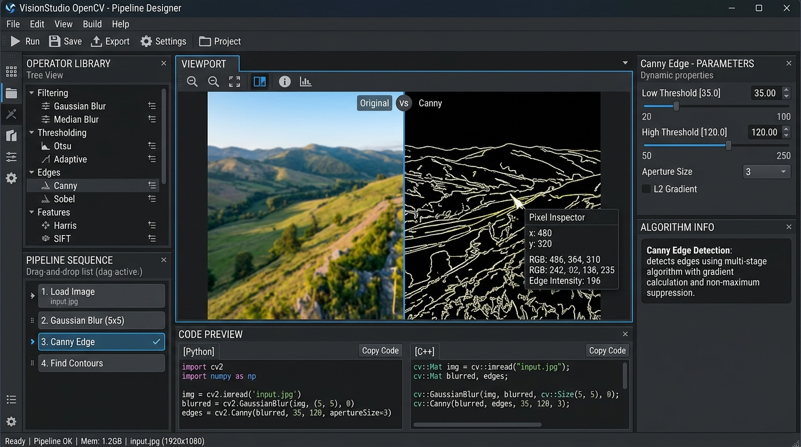

# VisionStudio OpenCV - 算法学习与代码生成工具
## 系统设计与可行性分析报告

---

## 目录
1. [项目背景与核心愿景](#一-项目背景与核心愿景)
2. [市面现有同类产品全景调研](#二-市面现有同类产品全景调研)
3. [技术选型与可行性论证](#三-技术选型与可行性论证)
4. [系统分层架构设计](#四-系统分层架构设计)
5. [核心接口与面向对象设计 (C++)](#五-核心接口与面向对象设计-c)
6. [界面布局与交互设计](#六-界面布局与交互设计)
7. [关键性能与稳定性设计机制](#七-关键性能与稳定性设计机制)
8. [工作量评估与里程碑路线图](#八-工作量评估与里程碑路线图)

---

## 一、 项目背景与核心愿景

### 1.1 痛点分析
* **学习成本高、反馈周期长**：初学者在学习 OpenCV 时，通常在 IDE 或 Jupyter Notebook 中反复修改参数、手动调用 `cv2.imshow` 和 `cv2.waitKey`，步骤割裂且低效。
* **参数调试缺乏直观感**：滤波核大小（`ksize`）、Canny 双阈值（`threshold1/2`）、自适应二值化块大小等参数对图像质量的影响难以实时直观对比。
* **多语言落地转换繁琐**：算法研究阶段常用 Python 验证，但工业落地需要 C++ (OpenCV) 或 C# (OpenCvSharp)。手动逐行转换代码费时且容易出错。

### 1.2 核心目标
打造一款基于 **Qt C++ + OpenCV** 的轻量级、高性能交互式图像处理调试工作台：
1. **即时交互**：拖拽滑动条即时反馈处理结果，达到 60 FPS 级实时交互体验。
2. **流水线编排**：支持自由添加算子、调整执行顺序、启用/禁用单步、查看中间步骤输出。
3. **多语言代码一键导出**：根据调优后的理想流程，自动生成 **Python (cv2)**、**C++ (OpenCV)** 和 **C# (OpenCvSharp)** 生产级代码。
4. **教学与原理解析**：内置算法中文说明、公式图解与参数推荐区间。

---

## 二、 市面现有同类产品全景调研

| 产品 / 项目 | 形态分类 | 优势 | 局限性与痛点 |
| :--- | :--- | :--- | :--- |
| **Halcon HDevelop**<br>*(MVTec)* | 工业商业标杆 | • 算子极度丰富<br>• 实时调参<br>• 一键导出 C/C++/C#/Python 代码 | 商业闭源、授权昂贵、采用私有语法与算子库，非 OpenCV 生态。 |
| **GRIP**<br>*(WPI Robotics)* | 开源工具 | • 节点连线式 (Node-based)<br>• 支持生成 Java/C++/Python | 专为机器人比赛目标检测设计，通用图像处理算子少，界面陈旧。 |
| **OpenCV-GUI**<br>*(GitHub 个人项目)* | 开源轻量工具 | • 线性 Pipeline 调参<br>• 导出 Python 代码 | 仅支持 10~20 个基础算子，缺乏中间步缓存与高级视口功能。 |
| **Adaptive Vision Studio** | 工业视觉平台 | • 强大的数据流图拖拽交互<br>• 工业落地成熟 | 偏向无代码工业自动化部署，代码导出不如 IDE 原生直观。 |
| **ImageJ / Fiji** | 科研图像工具 | • 宏录制器 (Macro Recorder) 自动生成代码 | 生态独立，非现代 OpenCV 编程模式。 |

> **结论与机会**：当前开源界缺乏一款**现代化 UI、专注 OpenCV 原生算子、兼顾学习与多语言代码生成**的高性能桌面工具，该项目具备显著的实用价值与社区需求。

---

## 三、 技术选型与可行性论证

### 3.1 核心技术栈：`Qt 6 / C++17` + `OpenCV 4.x`
1. **性能极致**：原生 C++ 结合 OpenCV 核心算法，处理单帧图像仅需 1~20ms，无任何解释器开销与跨语言封送（Marshalling）成本。
2. **UI 体系完备**：Qt 提供了工业级视口组件（`QGraphicsView` / `QOpenGLWidget`）和灵活的停靠窗口体系（`QDockWidget`），极适合构建专业级 IDE 界面。
3. **内存可控**：显式管理 `cv::Mat` 内存引用计数，可轻松实现多级处理结果的脏标记缓存机制。

---

## 四、 系统分层架构设计

遵循**单一职责原则 (SRP)** 与**依赖倒置原则 (DIP)**，严格分层，杜绝在 UI 中硬编码算法逻辑：

```
+-------------------------------------------------------------+
|                     1. UI 视图层 (Qt Widgets)                |
|   MainWindow | ImageViewer | PipelineWidget | PropertyPanel |
+-------------------------------------------------------------+
                              ↓ (Signals & Slots)
+-------------------------------------------------------------+
|                 2. 业务逻辑层 (Pipeline Management)          |
|   PipelineManager (执行调度 / 脏标记缓存 / 多线程异步计算)     |
+-------------------------------------------------------------+
                 ↓                                  ↓
+------------------------------------+  +---------------------+
|        3. 算子核心层 (Core)         |  | 4. 代码生成引擎     |
|   IOpNode (算子抽象接口)           |  | ICodeGenerator      |
|   OpRegistry (反射注册工厂)         |  | ├─ PythonCodeGen    |
|   ├─ Filter / Edge / Morph / Thresh|  | ├─ CppCodeGen       |
|   └─ Feature / Transform           |  | └─ CSharpCodeGen    |
+------------------------------------+  +---------------------+
                 ↓
+-------------------------------------------------------------+
|                        5. 基础与工具层                       |
|   MatUtils (Mat/QImage 转换) | Logger (统一日志)             |
+-------------------------------------------------------------+
```

---

## 五、 核心接口与面向对象设计 (C++)

### 5.1 算子抽象接口 (`IOpNode.h`)
```cpp
#pragma once
#include <opencv2/opencv.hpp>
#include <string>
#include <vector>
#include <variant>

enum class ParamType
{
    IntSlider,      // 整数滑动条 (如核大小、阈值)
    DoubleSlider,   // 浮点滑动条 (如 Sigma)
    ComboBox,       // 下拉选择框 (如 色彩空间、滤波类型)
    CheckBox        // 布尔开关 (如 L2Gradient)
};

struct OpParameter
{
    std::string Name;                           // 变量标识符
    std::string DisplayName;                    // 界面中文名称
    std::string Tooltip;                        // 中文算法提示
    ParamType Type;                             // 控件类型
    std::variant<int, double, bool> Value;      // 当前值
    std::variant<int, double> MinValue;         // 最小值
    std::variant<int, double> MaxValue;         // 最大值
    std::variant<int, double> Step;             // 步长
    std::vector<std::string> EnumOptions;       // 下拉枚举列表
};

class IOpNode
{
public:
    virtual ~IOpNode() = default;

    virtual std::string GetCategory() const = 0;
    virtual std::string GetName() const = 0;
    virtual std::string GetDisplayName() const = 0;

    /**
     * @brief 核心计算接口
     */
    virtual bool Process(const cv::Mat& input, cv::Mat& output) = 0;

    /**
     * @brief 获取参数元数据供 UI 动态构建面板
     */
    virtual std::vector<OpParameter>& GetParameters() = 0;

    /**
     * @brief 代码生成接口
     */
    virtual std::string GenerateCppCode(const std::string& inVar, const std::string& outVar) const = 0;
    virtual std::string GeneratePythonCode(const std::string& inVar, const std::string& outVar) const = 0;
};
```

---

## 六、 界面布局与交互设计

### 6.1 界面效果预览图


### 6.2 五大核心工作区布局

```
+----------------------------------------------------------------------------------------------------+
| 顶部: 菜单栏 (Menu Bar) & 常用快捷工具栏 (打开图片 / 保存工程 / 导出代码 / 运行重置)                 |
+----------------------+----------------------------------------------------+------------------------+
| 【左侧停靠区】        | 【中央主视口区 (Viewport)】                         | 【右侧停靠区】         |
|                      |                                                    |                        |
| 1. 算子库分类树       | • 交互式图像渲染视口 (支持滚轮缩放/拖拽漫游)          | 1. 动态参数调节面板    |
|   (滤波/边缘/二值化/  | • 支持【原图 vs 处理图】左右滑动分屏对比 (Split)    |   (Slider/SpinBox/     |
|    形态学/特征提取等) | • 悬浮像素拾取器 (显示 X, Y 坐标、RGB/HSV 像素值)   |    ComboBox/CheckBox)  |
|                      | • 工具条 (ROI 框选、自适应大小、1:1 缩放、直方图)  |                        |
| 2. 流水线序列 (Pipeline)|                                                   | 2. 算法原理与教学提示  |
|   (拖拽调整先后顺序、 |                                                    |   (中文原理解释、      |
|    勾选启用/禁用、    |                                                    |    参数推荐取值区间)   |
|    点击高亮查看该步)  |                                                    |                        |
+----------------------+----------------------------------------------------+------------------------+
| 【底部代码与控制台停靠区】                                                                          |
| • 实时多语言代码预览与一键复制: [ Python (cv2) ]  |  [ C++ (OpenCV) ]                                |
| • 状态栏: 当前图像分辨率 (1920x1080) | 流水线耗时 (3.2 ms) | 内存占用 | 状态正常                      |
+----------------------------------------------------------------------------------------------------+
```

---

## 七、 关键性能与稳定性设计机制

1. **增量计算与脏标记缓存（Dirty Cache）**：
   * 采用 `std::vector<cv::Mat> _stepCache` 缓存流水线每一步输出。
   * 用户修改第 $N$ 步参数时，第 $1 \sim N-1$ 步直接读取缓存，仅重新计算第 $N$ 步及其下游节点。
2. **大图交互性能优化（降采样代理机制）**：
   * 拖拽滑动条过程中：后台使用低分辨率代理图（Proxy Mat）做高帧率实时预览；
   * 用户松开鼠标（Slider Released）后：在后台工作线程中触发全分辨率原图计算，保证最终画质。
3. **数据通道与类型安全校验**：
   * 算子输入前自动校验类型（如 Canny 强制要求 8 位单通道灰度图），若不匹配则自动插入转换节点或界面给出友好告警，杜绝底层崩溃。

---

## 八、 工作量评估与里程碑路线图

### 阶段一：MVP 原型版本（周期：约 2 ~ 3 周）
* [x] 完成基于 CMake 的 Qt + OpenCV 工程脚手架搭建。
* [x] 实现核心 `IOpNode` 与 `PipelineManager` 增量缓存引擎。
* [x] 实现基础 UI：图像视口（缩放/平移）、算子列表、参数滑动条面板。
* [x] 接入首批 **15~20 个高频算子**（高斯/中值/均值滤波、Canny/Sobel/Laplacian、二值化/Otsu、膨胀/腐蚀、灰度化）。
* [x] 实现 Python 与 C++ 代码实时生成与导出。

### 阶段二：V1.0 完善版本（周期：约 3 ~ 4 周）
* [ ] 算子库扩充至 **50+ 个核心算子**（轮廓检测、霍夫变换、自适应阈值、形态学梯度、直方图均衡化）。
* [ ] 视口增强：原图/处理图左右滑动分屏对比（Split View）、悬浮像素探针、直方图浮窗。
* [ ] 工程文件保存与加载（`.json` 流水线序列化与反序列化）。
* [ ] 扩充 C# (OpenCvSharp) 代码生成支持。

### 阶段三：V2.0 高级特性（周期：约 3 ~ 4 周）
* [ ] 升级为 **DAG 节点图（Node Graph）** 编辑器，支持多分支融合与 Mask 操作。
* [ ] 支持用户自定义 Python 脚本节点扩展。
